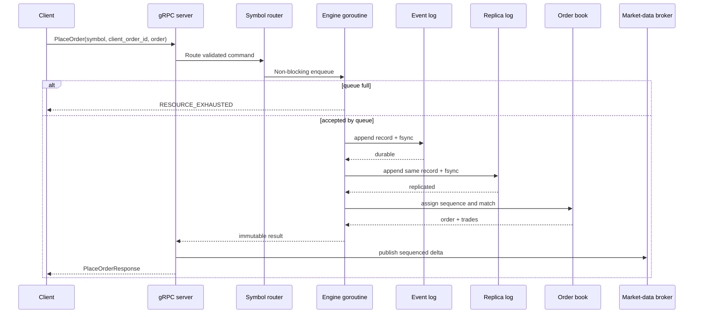
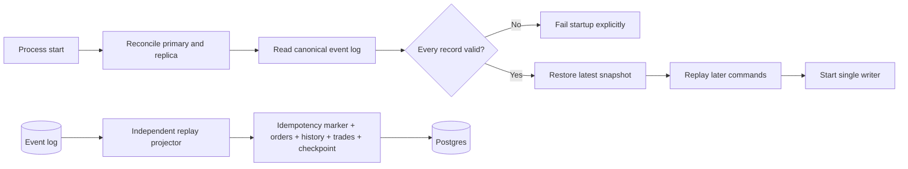

# Architecture

## Design goals

The service favors deterministic behavior, explicit overload, and recoverable
state over peak single-book throughput. Matching remains independent of
transport, storage projections, and observability. Parallelism is introduced
between symbols without introducing multiple writers inside one book.

## Component boundaries

| Component | Owns | Does not own |
| --- | --- | --- |
| Domain | Validated values, order lifecycle, trades | Concurrency, persistence, transport |
| Order book | Price-time matching and active-order indexes | Locks, I/O, client identity |
| Engine | Queue, sequence allocation, durability boundary | Symbols, gRPC, Postgres |
| Router | Engine lifecycle and isolation by symbol | Matching logic |
| gRPC server | Validation mapping, idempotency, streams | Book mutation |
| Event log | Checksummed append and snapshot files | Query projections |
| Projector | Replay and idempotent query models | Command acceptance |
| Observability | Metrics and profiles | Core business behavior |

## Accepted command path

Both configured event-log copies are written before in-memory mutation. Invalid commands are
rejected before the append and consume no sequence. A caller canceling its
context stops waiting but cannot roll back a command already accepted by the
engine queue.

## Recovery and projections

The append-only command log is the source of truth. Recovery regenerates
trades and book state through the deterministic matcher. A snapshot is an
optimization and records how many log entries it covers; it does not replace
the log.

Replica reconciliation accepts identical logs and strict-prefix relationships,
and repairs one missing, truncated, or corrupt copy from its valid peer.
Conflicting valid histories fail startup. This is synchronous local redundancy,
not a distributed leader/follower protocol; see ADR 0008.

Projection writes happen asynchronously in one database transaction per
event. A failed transaction cannot advance its checkpoint. Matching therefore
continues during a Postgres outage, while query models may temporarily lag.

## Multi-symbol ownership

The router lazily creates one engine per opaque symbol. Its registry lock is
held only for lookup or lifecycle changes; normal matching occurs through each
engine's independent queue. Shutdown first rejects new routing and then drains
all initialized engines concurrently.

Isolation is deliberate:

- queue pressure on one symbol does not fill another symbol's queue;
- sequence and identifier namespaces are local to a symbol;
- event logs and snapshots cannot escape the data directory because symbols
  become URL-safe base64 directory names;
- different symbols can use different CPU cores while preserving one writer
  per order book.

See the [ADRs](adr/) for decision history and
[`limitations.md`](limitations.md) for boundaries that are not hidden by the
diagram.
