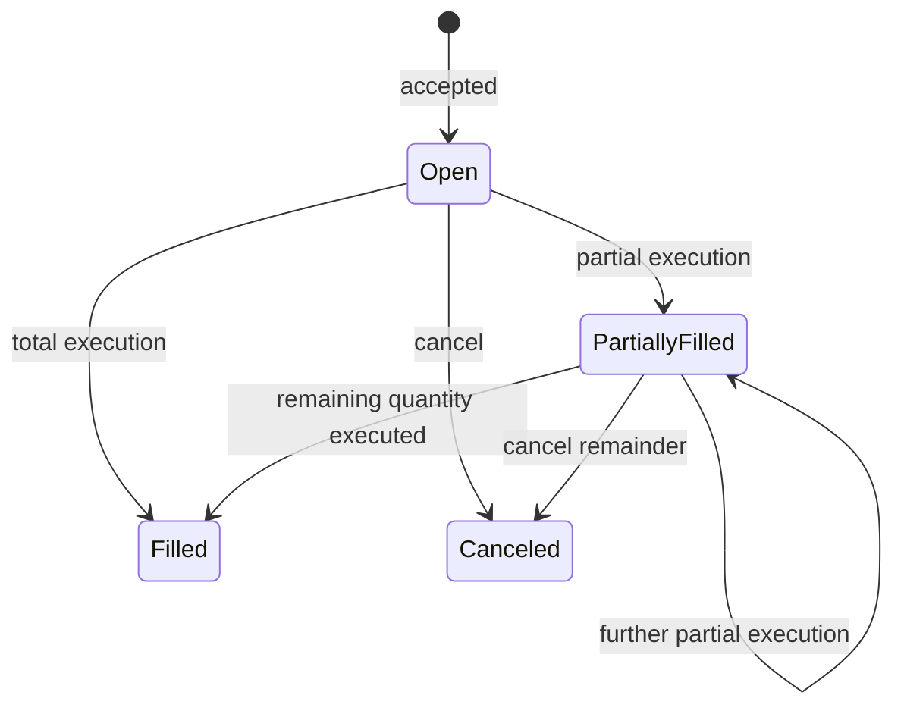

# Domain invariants and order semantics

## Numeric values and identity

- `Price` and `Quantity` are signed 64-bit integers and must be positive.
  Fixed-point scale and currency belong to the caller or instrument catalog.
- Symbols and order IDs must be non-empty. Symbols are otherwise opaque and
  case-sensitive.
- Sequences start at one and increase monotonically inside one symbol.
- Order IDs, trade IDs, client order IDs, and sequences are unique only in the
  context of their symbol.
- Client timestamps and client-provided sequence numbers are intentionally
  absent from commands and cannot affect priority.

## Supported orders and time in force

| Order type | Valid TIF | Behavior |
| --- | --- | --- |
| Limit | GTC, IOC, FOK | Matches up to its limit; GTC remainder rests |
| Market | IOC | Matches any available price; remainder is canceled |
| Stop-market | GTC while dormant | Activates as market IOC at its stop price |
| Stop-limit | GTC | Activates at its trigger and uses its configured limit price |
| Iceberg | GTC | Rests only its configured visible tranche |

`IOC` executes immediately and cancels its remainder. `FOK` first scans
eligible liquidity, including hidden iceberg remainder and STP exclusions; it
either fills completely or is accepted directly into a canceled terminal
state without touching makers. Market prices must be zero. Limit and iceberg
prices, quantities, and stop trigger prices must be positive.

A rejected command does not mutate the book or consume a sequence. An accepted
IOC/FOK/market order may legitimately return canceled with zero or partial
execution.

## Priority and execution

- Bids execute from highest price to lowest; asks from lowest to highest.
- Orders at one price execute FIFO by engine-assigned sequence.
- An incoming buy crosses while its limit is at least the best ask. An
  incoming sell crosses while its limit is at most the best bid.
- Every trade uses the resting maker's price.
- One incoming order may consume multiple makers and price levels.
- Any unfilled remainder of a GTC order rests at its limit price.
- Buy stops fire when a trade is at or above the stop price; sell stops fire
  when a trade is at or below it. Stops already through the market activate
  immediately when placed.
- Dormant stops are queryable but absent from bid/ask snapshots.
- An iceberg exposes at most `display_quantity`. When a tranche is depleted,
  the next tranche moves to the back of that price level.
- Empty price levels and filled orders are removed from active indexes.
- After each command, the book cannot contain a best bid greater than or equal
  to the best ask.

For every order:

```text
original quantity = remaining quantity + executed quantity
remaining quantity >= 0
executed quantity <= original quantity
```

Every trade quantity is applied equally to maker and taker, so quantity is
conserved across execution.

## Lifecycle and cancellation



Filled and canceled states are terminal. Cancellation removes only the active
order's indexed list element, preserving FIFO for other orders at that price.
Queries retain terminal orders, while book snapshots contain only active
remaining quantities.

Accepted orders, generated trades, and successful cancellations consume the
same monotonic sequence. A placement consumes one sequence for the order and
one more per trade it generates. A trade ID is the decimal representation of
its sequence. A successful cancellation consumes one sequence because it
changes visible market state.

`MassCancel` is one atomic engine command and consumes one sequence. It
cancels all active and dormant orders in the symbol, or only those belonging
to an optional participant. Results are returned in original acceptance order.
At the API layer, omitting the symbol with a participant applies one such
command to every known symbol in lexical order. That cross-symbol operation is
not atomic: an error can occur after earlier books were already canceled.

## Self-trade prevention

STP is evaluated when maker and aggressor have the same non-empty participant
ID. The incoming order selects one of these policies:

- `NONE`: execute normally;
- `CANCEL_AGGRESSOR`: cancel the incoming remainder;
- `CANCEL_RESTING`: cancel the resting order and continue matching;
- `CANCEL_BOTH`: cancel maker and aggressor without a trade.

STP cancellations are deterministic effects of the placement command and are
included in its affected-order result. They do not create synthetic trades.

## Concurrency and overload

An `OrderBook` is intentionally not concurrency-safe. Its owning engine
serializes placements, cancellations, and consistent queries through a
bounded FIFO channel. A full queue is rejected immediately; it is never an
unbounded memory buffer. Shutdown rejects new submissions and drains already
accepted commands.

Canceling a caller context can prevent enqueue or stop that caller from
waiting. It does not undo a command that already entered the engine queue.

## Durability and replay

For persistent engines, a mutation is considered accepted only after its
versioned command record and checksum have been fully written and `fsync`
completes on the primary and, when configured, its replica. The in-memory
mutation happens afterward. A partial write or failed flush makes that log
writer unusable until restart.

On restart, a valid snapshot is restored and commands after its log offset are
replayed. Corruption, truncation, unsupported versions, sequence gaps, or an
invalid replay fail startup instead of guessing. A missing, corrupt, truncated,
or strict-prefix copy is repaired from its valid peer; conflicting histories
fail startup. Identical accepted command sequences must produce identical
orders, trades, and snapshots.

## API idempotency and market data

`client_order_id` idempotency is scoped to symbol and process lifetime. An
identical retry returns the cached response; the same ID with a different
payload is a conflict. Engine order-ID uniqueness is independent of that
transport-level registry.

A stream begins with a consistent snapshot. Each later delta declares the
previous and new high-water sequences. Consumers must reconnect when those do
not join their local high-water mark. A bounded slow subscriber is disconnected
explicitly rather than receiving a stream with silent gaps.
